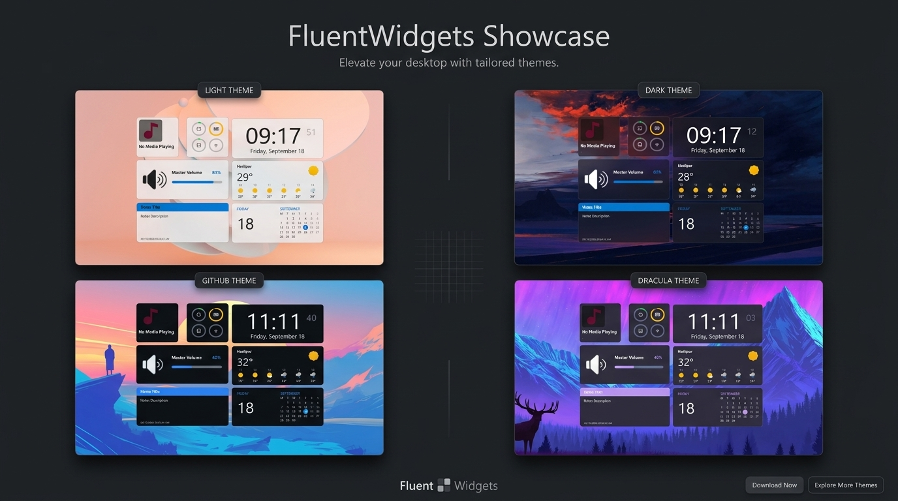

<p align="center">
  
</p>

<p align="center">
  A small collection of desktop widgets for Novadesk.
</p>

<p align="center">
  
  
  
  
</p>

<p align="center">
  
</p>

## About

FluentWidgets is a Novadesk widget package with a Windows-inspired settings experience. It keeps the common desktop information close at hand without turning the desktop into a full dashboard.

The package includes widgets for:

- Clock
- Calendar
- Weather
- System monitor
- Music playback
- Notes
- Volume

The Settings window lets you enable the widgets you use, choose a theme, set your location, adjust UI scale and transparency, choose a window corner style, and select a backdrop effect.

## Requirements

- Windows
- [Novadesk](https://novadesk.pages.dev/)
- The bundled `BlurBehind` and `NowPlaying` Novadesk add-ons

## Download

Download the latest installer from the project releases:

[Download FluentWidgets_vX.X.X.X_Setup.exe](https://github.com/NSTechBytes/FluentWidgets/releases)

Run the installer, then launch FluentWidgets from the Start menu or desktop shortcut. Novadesk must be installed before running the package.

## Run from source

Clone or download this folder, then start it through the Novadesk Widget Manager:

```powershell
cd D:\Novadesk-Project\FluentWidgets
nwm run
```

The project entry point is `index.js`. If your Novadesk executable is in a different location, use the Widget Manager configuration or start Novadesk with this file as its script.

## Settings

Configuration is stored in `config/config.json`.

The General tab includes the following options:

- Theme: Dark, Light, Dracula, or GitHub
- Blur Effect: None, Acrylic, or Blur
- Background opacity and UI scale
- Weather city, latitude, and longitude
- Corner style and 24-hour clock format

Changes made in the Settings window are saved immediately. Acrylic uses the BlurBehind add-on and falls back to Blur on Windows versions where Acrylic is unavailable.

## Patreon

<p align="center">
  <a href="https://patreon.com/cw/nstechbytes">
    
  </a>
</p>

If FluentWidgets is useful to you, supporting the project on [Patreon](https://patreon.com/cw/nstechbytes) helps cover the time spent maintaining widgets, improving the settings experience, and testing new Novadesk releases. Support is optional, but it makes continued work on the project possible.

## License

FluentWidgets is licensed under the [Apache License 2.0](LICENSE).
